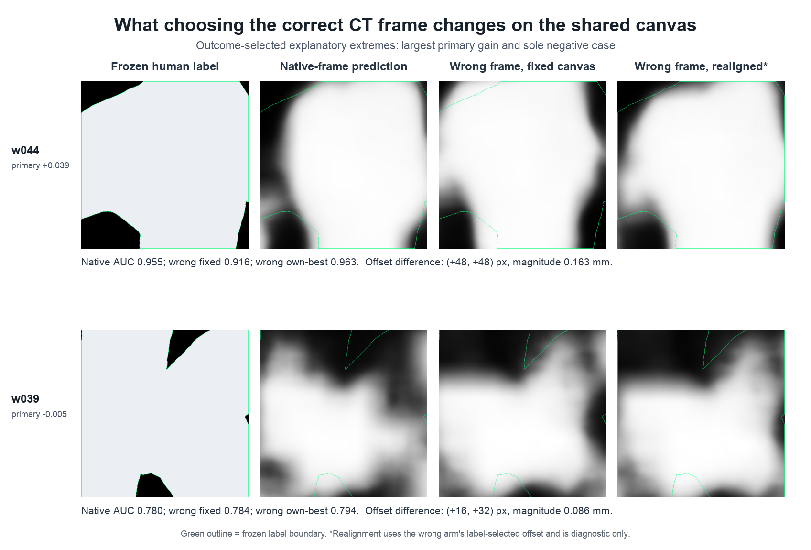

# Frame-resolver displacement interpretation — result

## Outcome

Across all eight frozen cases, the wrong-frame prediction's independently
selected evaluation offset differed from the native prediction's offset by a
median **0.104 mm** and mean **0.116 mm** on the target canvas. Magnitudes
ranged from **0.054 to 0.192 mm**.

These numbers quantify the extra label-selected alignment burden in this
evaluator. They are not physical mesh-registration ground truth: the offsets
are label-derived, quantized, and can include ink-model and annotation noise.



## Complete displacement table

`Delta pixels` is wrong-frame own-best offset minus native best offset at full
2.399 um canvas resolution.

| Segment | Delta pixels (y, x) | Magnitude | Primary AUC delta | Own-align AUC delta |
|---|---:|---:|---:|---:|
| w030 | (+16, +32) | 0.086 mm | +0.02882 | +0.01456 |
| w040 | (+16, +16) | 0.054 mm | +0.00339 | -0.00237 |
| w041 | (+16, +32) | 0.086 mm | +0.00810 | +0.01020 |
| w043 | (-16, +48) | 0.121 mm | +0.01495 | -0.00783 |
| w044 | (+48, +48) | 0.163 mm | +0.03892 | -0.00743 |
| w045 | (+64, +48) | 0.192 mm | +0.03769 | -0.00575 |
| w039 | (+16, +32) | 0.086 mm | -0.00488 | -0.01475 |
| w035 | (+48, +32) | 0.138 mm | +0.02061 | +0.02721 |

## Descriptive association

Across these eight cases, displacement magnitude and primary AUC delta had:

- Pearson r = 0.787 (two-sided descriptive p = 0.0206);
- Spearman rho = 0.781 (two-sided descriptive p = 0.0222).

This is consistent with the interpretation that larger frame-induced spatial
burden tends to cost more fixed-canvas AUC. With only eight non-independent,
preselected benchmark windows, it is not a population-level or causal claim.

## Case-study selection and reading

The figure deliberately shows outcome-selected extremes, not representative
random cases:

- w044 had the largest positive primary delta (+0.03892); its offset difference
  was (+48, +48) pixels, or 0.163 mm;
- w039 was the sole negative primary case (-0.00488); its offset difference
  was (+16, +32) pixels, or 0.086 mm.

Within each frozen window, the displayed 512 x 512 crop was selected by the
precommitted rule of maximum positive-label count. Native and wrong-frame
predictions use the same intensity scale within each row, and the green label
boundary is identical across its prediction panels. The realigned panel uses
the wrong arm's independently label-selected offset and is diagnostic only.

## Reproduction and resources

Analysis plan: `f58915a`. Executable code:
`e04b2de5ce2c66921105b582d95aea0817fdf1cc`.

```bash
OMP_NUM_THREADS=2 OPENBLAS_NUM_THREADS=2 VECLIB_MAXIMUM_THREADS=2 \
  PYTHONPATH=src .venv/bin/python src/analyze_frame_displacement.py
```

The run took 5.7 seconds with maximum RSS of 311,853,056 bytes. Machine data
are in
[`frame_resolver_displacement.json`](../evidence/multicase/frame_resolver_displacement.json).
