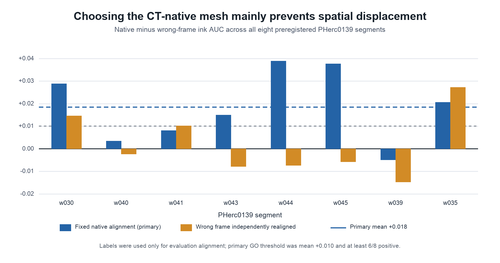

# Frame resolver: eight-case consequence test

## Outcome

**GO on the preregistered primary endpoint.** Selecting the mesh made in the
requested CT frame improved mean ink AUC by **+0.01845** relative to mapping a
mesh from the 9.362 um frame into the 2.399 um frame. Seven of eight segments
were positive; the deterministic segment-bootstrap 95% interval was
**[+0.00823, +0.02872]**.

This is evidence that the metadata-only frame resolver prevents a measurable
downstream error on a fixed canvas. It is not evidence that the mapped mesh has
intrinsically worse ink features after label-assisted realignment: when the
wrong-frame prediction was allowed to choose its own best label alignment, the
mean advantage fell to **+0.00173 AUC** and only 3/8 cases were positive.



## Complete result

The primary comparison chooses one evaluation offset from the native
prediction, then reuses the same offset and label mask for the wrong-frame
prediction. `Own-align delta` is the conservative secondary diagnostic in which
the wrong-frame prediction gets its own label-selected offset.

| Segment | Native AUC | Wrong-frame AUC | Primary delta | Wrong own-best AUC | Own-align delta |
|---|---:|---:|---:|---:|---:|
| w030 | 0.93070 | 0.90187 | +0.02882 | 0.91614 | +0.01456 |
| w040 | 0.85119 | 0.84779 | +0.00339 | 0.85356 | -0.00237 |
| w041 | 0.89479 | 0.88669 | +0.00810 | 0.88459 | +0.01020 |
| w043 | 0.89270 | 0.87774 | +0.01495 | 0.90053 | -0.00783 |
| w044 | 0.95523 | 0.91631 | +0.03892 | 0.96265 | -0.00743 |
| w045 | 0.84380 | 0.80611 | +0.03769 | 0.84954 | -0.00575 |
| w039 | 0.77961 | 0.78449 | -0.00488 | 0.79436 | -0.01475 |
| w035 | 0.79369 | 0.77308 | +0.02061 | 0.76648 | +0.02721 |
| **Aggregate** | | | **mean +0.01845** | | **mean +0.00173** |

Primary median delta was +0.01778. The worst primary case was w039 at
-0.00488. The frozen GO rule required mean gain at least +0.010 and at least
6/8 positive cases; the observed result met both conditions.

A separately preregistered scorer-sensitivity audit retained GO in all 36/36
alignment-grid and evaluation-mask configurations. Mean gain ranged from
+0.01422 to +0.01937, every configuration stayed 7/8 positive, the exact
one-sided sign-test probability was 0.0352, and the exact paired mean sign-flip
probability was 0.0117. See
[`SENSITIVITY_RESULT.md`](SENSITIVITY_RESULT.md).

## What was held fixed

- All eight pre-existing labelled PHerc0139 cases and their frozen C2 windows.
- Target CT: `20260102150214-2.399um-0.2m-78keV-masked.zarr`.
- Canonical 2 um ink checkpoint: `r152_3ddec_v2_l5_epoch13.ckpt`.
- Local rendering and inference parameters, including 65 layers, level 1,
  two render workers, batch one, and identical target-canvas windows.
- Wrong-frame mapping: `official_9to2.json` from immutable scroll-lineup commit
  `fb35a11d7d469beb131256c041267a99397e55f7`.

The only arm difference was the mesh source: the native 2.399 um mesh versus
the 9.362 um mesh mapped into the target frame. Labels did not select the mesh,
transform, render, model, window, or case inclusion; they were used only for
the frozen evaluation alignment and AUC.

## Interpretation and limitation

The gap between the primary and independently realigned results is the main
finding, not a detail to hide. Choosing the correct frame prevents the ink map
from landing in the wrong place on a shared canvas. If downstream software can
perform a separate label-assisted realignment, most of the average AUC gap
disappears. Real use generally lacks those ink labels, which is why resolving
the frame from metadata before rendering remains useful.

The independently selected offsets imply a median additional evaluation
alignment burden of 0.104 mm for the wrong-frame arm (range 0.054–0.192 mm).
The complete vector table, descriptive association, and outcome-selected w044
and w039 images are in
[`INTERPRETABILITY_RESULT.md`](INTERPRETABILITY_RESULT.md).

The native AUC values are not direct reproductions of `reference_2399` in the
older C2 table. C2 scored ScrollPrize's precomputed published surface volumes;
this paired experiment locally rendered both mesh arms using the same 65-layer
configuration. The paired arm comparison is therefore the valid endpoint.

## Reproduction and provenance

The experiment was frozen before the new arms were scored in
[`PREREGISTRATION.md`](../evidence/multicase/PREREGISTRATION.md).
The scoring-run code SHA was
`14561ef0e422ad4aa2a13a4f43b6569a3454f4f8`; the preregistration SHA was
`01c0da224da345bbde915ab874abbf6584753464`.

```bash
bash runs/frame_resolver_multicase_lowmem.sh
python src/plot_frame_multicase.py \
  results/frame_resolver_multicase.json \
  artifacts/frame_resolver_multicase_deltas.png
```

The machine-readable aggregate is
[`frame_resolver_multicase.json`](../evidence/multicase/frame_resolver_multicase.json),
and the eight case records are in
[`evidence/multicase/cases/`](../evidence/multicase/cases/).
Each case record contains both prediction hashes, offsets, labelled-pixel
counts, AUCs, and code/preregistration SHAs. Raw render stacks and streamed CT
chunks were deleted only after their case result was written successfully.
